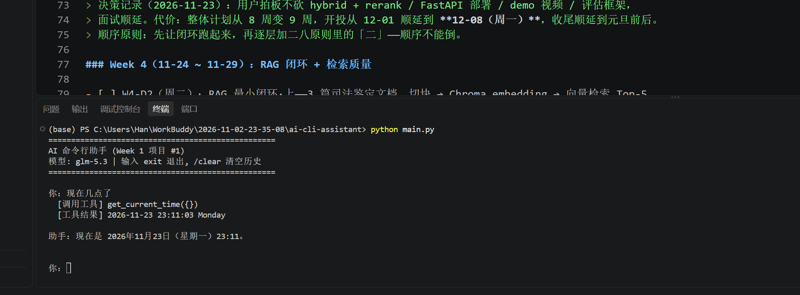

# 项目 #1：AI 命令行助手

> 8 周冲刺计划的第一个作品。目标：跑通「LLM API + 工具调用 + 多轮对话」全链路。
> 这个项目要最终写进简历，所以从第一天起就按「给别人看」的标准维护。

## 它能做什么

- 多轮对话，带上下文记忆
- 调用工具：获取当前时间、读取项目内文件
- 防死循环保护、路径越权防护（面试可讲的两个安全设计点）

## 快速开始

```bash
pip install -r requirements.txt
copy .env.example .env    # 填入 API Key
python main.py
```

试试问它：「现在几点了？」「帮我看看 README.md 里写了什么」

## 架构

```
main.py                 CLI 入口，维护消息历史
assistant/
  config.py             密钥与模型配置（.env 加载）
  tools.py              工具注册表（schema + 实现）
  loop.py               Agent 循环（调用 → 执行 → 回填 → 继续）
```

## 原理：LLM 是怎么调用工具的

**一句话**：模型负责决策，代码负责执行，结果回灌给模型再决策，直到模型不再要工具。这套循环叫 ReAct，也叫 Agent Loop。

**两层循环，别混**：

- `main.py` 的 `while True` 管**多轮对话**：你说一句它答一句，输入 `exit` 才结束
- `loop.py` 的 `for _ in range(MAX_ITERATIONS)` 管**一轮内多步调用**：`MAX_ITERATIONS` 限制的是「最多几次 LLM 往返」，不是「最多几次工具调用」——一次往返里模型可以同时要 3 个工具

**一次工具调用的真实消息流**（关键是 `messages` 是个活列表，每圈都在变长）：

```
圈 1  发：[system, user]                                    ← 2 条
      收：assistant，content 为空，tool_calls=[{id, name, arguments}]
      做：代码执行工具，把 assistant 消息和 tool 结果都 append 进历史
圈 2  发：[system, user, assistant(tool_calls), tool(结果)]  ← 4 条
      收：assistant，纯文字回答 → 走「情况 a」return，循环结束
```

所以单次工具调用标准就是**两圈**。第二次和第一次不一样的地方，就是多了那两条消息。

**三个容易踩的细节**：

1. **`id` 是凭证不是装饰**。`role:"tool"` 的消息靠 `tool_call_id` 认领「我是哪次调用的结果」，粒度是**每次调用请求**，不是每轮——一轮 3 个工具就有 3 个 id
2. **`arguments` 是 JSON 字符串**，不是字典。回传时原样带走，`json.loads` 只发生在 `execute_tool` 内部
3. **assistant 那条必须 append 回去**。API 无状态，每次请求都重发完整历史；漏了这条，tool 消息就成了没有爹的孤儿。OpenAI 官方 API 会 400，但部分国内兼容网关（如智谱）不校验、照跑——**兼容端点的宽容不等于规范允许**，按最严的写

## TODO（Week 1 打卡清单，做完一项勾一项）

- [x] 配好 .env，`python main.py` 跑起来（2026-11-03 凌晨完成，附带首次真实调试：修了 tools.py 结构 bug）
- [x] 读 `assistant/loop.py`，用自己的话在 README 写清「LLM 是怎么调用工具的」（2026-11-04 凌晨完成，含 print 实验：消息数 2 → 4）
- [x] **动手**：自己加一个新工具 `list_project_files()`（2026-11-05 完成：AI 生成 + 人工 review，修了「整段插入导致重复定义」的事故；验收通过，返回 4 个 .py 文件）
- [x] **动手**：给助手加「记住用户名字」功能（2026-11-06 完成并**实跑验收通过**：`set_user_name` 工具 + `user_profile.json` 持久化 + `load_user_name` 注入 system prompt；「我叫张三」→ 工具调用 → 改名李四后档案为 `{"name":"李四","historyname":["张三"]}` → exit 重启后仍记得。离线验证另含文件不存在/JSON 损坏兜底、坏参数兜底）
- [x] **动手**：把 tools.py 里的 `import json` 挪到文件顶部（已在顶部，`execute_tool` 内只保留 `json.loads`；`main.py` 曾被粘入问答模式的无效片段，已清理）
- [x] 用 Git 初始化仓库（2026-11-06 完成：`cfa196f` 首次提交；`18f4b49` 把运行时 `user_profile.json` 移出版本库。`.env` 与用户档案均已排除，未入库）
- [x] 推到 GitHub（2026-11-23 完成：远端 `master` 已与本地 `993d0ec` 同步，github.com/JDesireHan/ai-cli-assistant 不再是空仓库。提交身份早已改为 `JDesireHan`）
- [x] README 补一张运行截图（2026-11-25 完成：`docs/screenShot.png` 已提交，README「快速开始」第 13 行已引用）

## Week 4-5 打卡清单（2026-11-23 ~ 12-06，RAG 完整版，投递定在 12-08）

> 决策记录（2026-11-23）：用户拍板不砍 hybrid + rerank / FastAPI 部署 / demo 视频 / 评估框架，
> 面试顺延。代价：整体计划从 8 周变 9 周，开投从 12-01 顺延到 **12-08（周一）**，收尾顺延到元旦前后。
> 顺序原则：先让闭环跑起来，再逐层加二八原则里的「二」——顺序不能倒。

### Week 4（11-24 ~ 11-29）：RAG 闭环 + 检索质量

- [ ] W4-D2（周二）：RAG 最小闭环·上——3 篇司法鉴定文档，切块 → Chroma embedding → 向量检索 Top-5
- [ ] W4-D3（周三）：闭环·下——检索结果喂给 LLM 生成，回答带引用来源 + 拒答逻辑（得分低于阈值就说「文档里没有」）
- [ ] W4-D4（周四）：**hybrid 检索**——BM25 + 向量加权融合，保留 5 个查询的前后对比记录
- [ ] W4-D5（周五）：**rerank** 接入（bge-reranker 本地跑或 API rerank），截图记录重排前后 Top-5 的变化
- [ ] W4-周六：10 个测试问题 + 用 Promptfoo（或 RAGAS）跑一组评估，拿到准确率数字
- [ ] W4-周日：新建 RAG 仓库，README 四段式（业务问题 → 技术选型 → 难点 → 结果），**重点写 hybrid/rerank 的前后消融对比数据**——这是面试区分度最大的素材——push

### Week 5（11-30 ~ 12-06）：部署打磨 + 简历

- [ ] W5-D1（周一）：FastAPI 接口（`POST /ask`，返回答案 + 引用来源）
- [ ] W5-D2（周二）：部署到免费平台（Render / Railway / Zeabur），拿到公网 URL，README 挂链接
- [ ] W5-D3（周三）：录 2 分钟 demo 视频（不公开链接即可）
- [ ] W5-D4（周四）：评估补强（Promptfoo 深化或 RAGAS 指标），README 数据更新
- [ ] W5-D5（周五）：简历 v1（两个项目按四段式）+ 顺手补 cli-assistant 的运行截图
- [ ] W5-周末：Boss 直聘/拉勾注册、搜索关键词备好（AI 应用开发 / LLM 应用 / AIGC 开发 / Agent 开发）、目标公司清单 30 家

### **12-08（周一）开投**：先投 20-30 家练手，投递后每周五打卡追加「本周投了几份」检查项

## Week 2 预告

这个项目会在 Week 2 升级成 RAG：给它接上向量库，让它能回答「司法鉴定文档」里的专业问题。
